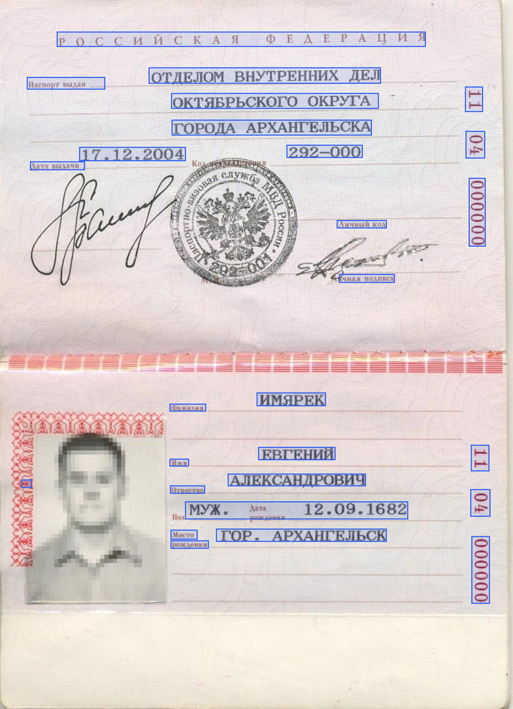
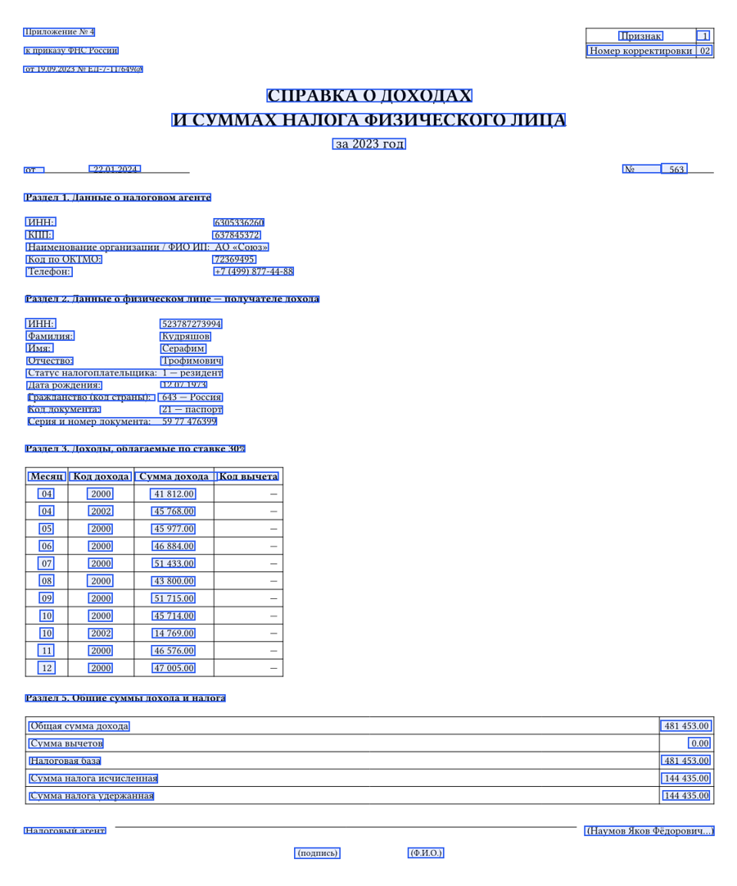
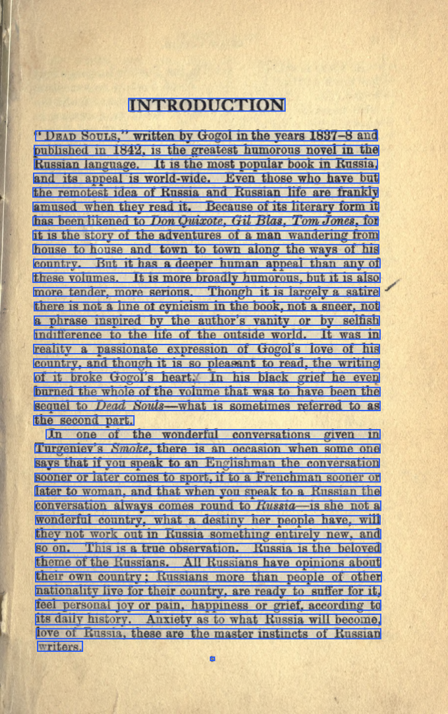
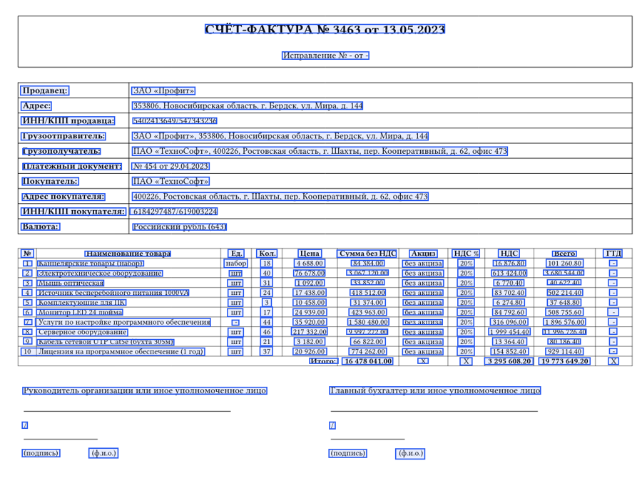
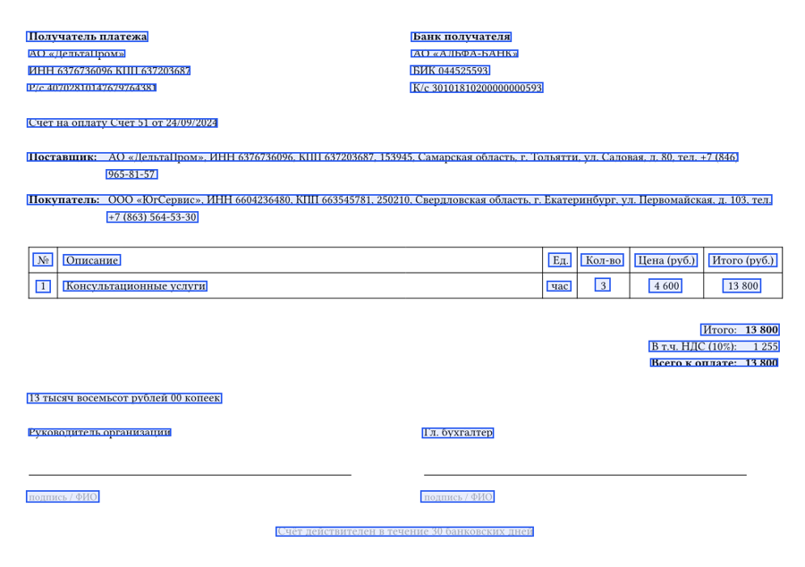
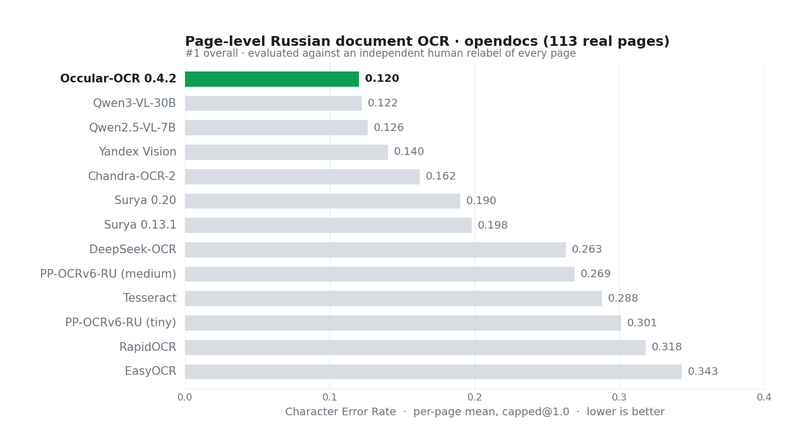

<div align="center">

# Occular-OCR

**State-of-the-art OCR for Russian documents — with a zero-compilation install.**

[](LICENSE)
[](WEIGHTS_LICENSE.md)
[](#installation)
[](#installation)

<sub>🇬🇧 **English** &nbsp;·&nbsp; <a href="#russian">🇷🇺 Русский</a></sub>

</div>

Occular-OCR is a document OCR library purpose-built for **Russian**. It pairs a DBNet text detector with an
SVTR recognizer and a beam-search decoder guided by a Russian language model — and reads Russian
documents **markedly better than existing open-source OCR**, especially the hard stuff: forms,
certificates, bank statements, IDs, receipts.

It installs with a single `pip install` on Windows, Linux and macOS — **no C/C++ toolchain, no CUDA,
nothing to build.**

---

## See it in action

<p align="center">
  
  
  
</p>
<p align="center">
  
  
</p>

<p align="center"><sub>Detected text lines on <b>synthetic / specimen / public-domain</b> documents — a passport, a tax certificate, a printed book page, a VAT invoice, a payment invoice.</sub></p>

## Why Occular-OCR

Occular-OCR is built for Russian and reads it dramatically better than existing open-source OCR:
**~35 % fewer word errors than the next-best open-source engine** in an end-to-end benchmark, and
ranking **#1** against large vision-language models and other leading OCR engines on a page-level
document benchmark. The gap is widest exactly where general-purpose OCR struggles: dense forms,
certificates, invoices and IDs.

<p align="center">
  <picture>
    <source media="(prefers-color-scheme: dark)" srcset="assets/benchmark_opendocs_dark.png">
    
  </picture>
</p>
<p align="center"><sub>Character error rate (per-page mean, capped) on <b>113 real Russian document pages</b>, scored against an independent, per-page ground truth built with Fable. Lower is better.</sub></p>

The pages are a cross-section of everyday Russian paperwork — powers of attorney, bank
statements, invoices and VAT invoices, passports and IDs, contracts, certificates, applications
and receipts. Because every page is a genuine document carrying private individuals' personal
data, **the benchmark itself is not published.** That is also exactly why it matters: these are
real, in-the-wild production documents, so the numbers reflect how OCR actually behaves on live
document workloads far better than any synthetic or public dataset can.

- **Russian-first accuracy.** Trained and tuned on Russian document data. Where other engines guess,
  Occular-OCR reads.
- **Beam + language model, on by default.** A Russian n-gram language model cuts word errors
  ~18–25 % over plain greedy decoding — with **no model retraining**, just better decoding.
- **Fast by default.** The default recognizer (`svtr_lcnet`) reads a dense page about **5× faster**
  on CPU than the previous one while keeping 99.6 % of its accuracy. The larger model is still one
  argument away: `recognizer="svtr_t"`.
- **Handles sideways pages.** Turn on `orientation=True` and Occular detects a 0/90/180/270°
  rotation and straightens the page before reading it — for phone photos and bulk scans that come
  in rotated. Off by default; it only rotates when it is confident.
- **Installs anywhere, no compiler.** The decoder is pure Python end to end, so you get top-tier
  decoding quality with **zero native dependencies**.
- **CPU-first, GPU-ready.** Every model is ONNX and runs on CPU out of the box; set `gpu=True` to run the same models on CUDA through ONNX Runtime — no PyTorch.
- **Batteries included.** Images and PDF, folder → `.txt`, tables (Markdown or cell by cell), reading
  order, automatic deskew, and multi-page work spread across all CPU cores.

---

## Installation

```bash
pip install occular-ocr
```

That's it. No build tools, no CUDA. Model weights download automatically on first use and are cached
locally. Every dependency installs from a prebuilt wheel — nothing is compiled — on:

- Linux x86_64 and aarch64 (glibc 2.28+: Ubuntu 18.10+, Debian 10+, RHEL 8+);
- Windows x64;
- macOS 11+ on Apple silicon and Intel. ONNX Runtime limits newer Pythons: Python 3.13 needs
  macOS 13+, Python 3.14 needs Apple silicon with macOS 14+ (no Intel build); use Python ≤ 3.12 on
  older Macs.

On 64-bit Windows nothing else is needed: the Windows wheel carries the Microsoft Visual C++ runtime that
ONNX Runtime, PyMuPDF and pyclipper need, and uses it only when Windows has no copy of its own.

Python 3.8–3.14; Python 3.15 is not supported yet (no ONNX Runtime build). Old pip versions don't
recognise current Linux wheels — on Ubuntu 20.04 and similar the bundled pip 20 reports "No matching
distribution found for onnxruntime"; run `python -m pip install -U pip` first.

Windows on ARM is not supported (several dependencies have no ARM builds). If pip ever starts compiling
something, `pip install --only-binary=:all: occular-ocr` makes it use the newest prebuilt version instead.

### GPU (optional)

Every model is ONNX; on GPU the same files run on CUDA through ONNX Runtime, so there are no extra
weights and no PyTorch. On Linux and Windows the base install already uses the GPU build of ONNX
Runtime (it runs on CPU just as fast when there is no GPU). The extra only adds the CUDA and cuDNN
libraries from pip, so you need nothing but an NVIDIA driver:

```bash
pip install "occular-ocr[gpu]"    # CUDA + cuDNN from pip; no system CUDA needed
```

Then pass `gpu=True` (see below). If CUDA can't be loaded, Occular says why once and runs on CPU.
TF32 is disabled on GPU, so the text matches the CPU path.

ONNX Runtime 1.27 and newer is built for CUDA 13 and needs an NVIDIA driver that supports CUDA 13. With
an older driver (CUDA 12.x) it falls back to CPU; keep the last CUDA 12 build instead:
`pip install "onnxruntime-gpu[cuda,cudnn]<1.27"`.

---

## Quick start

```python
from occular import ocr

text = ocr("document.png")        # an image, or a "scan.pdf"
print(text)
```

Line-level output with coordinates and confidence:

```python
from occular import ocr_detailed

for line in ocr_detailed("document.png"):
    print(line["text"], round(line["confidence"], 2), line["quad"])
```

A whole folder → text files, from the command line:

```bash
ocr ./scans ./out          # writes ./out/<name>.txt for every image/PDF
```

> First run downloads the model weights automatically (and caches them). No build tools, no CUDA.

## Configuration

All behaviour is controlled by `Settings` (or the equivalent keyword arguments on `ocr`). Print the
current defaults at any time:

```python
from occular import Settings
print(Settings())
```

| Setting | Default | What it does |
|---|---|---|
| `num_threads` | `None` | CPU threads per page. `None` → `min(cores, 8)`; beyond ~16 a single page gets no faster. For many pages use `workers`. |
| `gpu` | `False` | Run on **GPU (CUDA via ONNX Runtime)**. CUDA libraries: `occular-ocr[gpu]`; falls back to CPU if unavailable. |
| `orientation` | `False` | Detect a 0/90/180/270° page rotation and straighten it before detection — for phone photos and bulk scans that arrive sideways. Applied only when the model is at least 0.8 confident. |
| `deskew` | `True` | Auto-correct skewed scans (a few degrees) before detection. |
| `unwarp` | `False` | Neural dewarping (UVDoc, ONNX) for curved or photographed pages. `True` → dewarp only when the text then reads better (each page is recognized twice, ~2× time); `"always"` → always dewarp, without the check (hurts flat pages). The model is downloaded on first use. |
| `lm` | `True` | Beam search + language model (best quality). `False` → fast greedy decoding, skips the LM download. |
| `reading_order` | `True` | Reading order by layout regions: multi-column pages are read column by column (see [below](#reading-order)). `False` = plain top to bottom. |
| `tables` | `False` | Find tables and put the recognized lines into their cells; in plain text tables come out as Markdown tables. See [Tables](#tables). |
| `languages` | `None` | Text language(s). `None` → Russian/English. A list of codes (e.g. `["uk"]`) or `"auto"` enables the multilingual model (12 more Cyrillic-script languages). See [Languages](#languages). |
| `detector` | `None` | Explicit detector name. `None` → default. |
| `recognizer` | `None` | Recognizer architecture: `"svtr_lcnet"` (default — light, ~5× faster on CPU) or `"svtr_t"` (the larger model). Both run on CPU and GPU. |

### Full pipeline with every setting

```python
from occular import OCRPipeline, Settings

pipe = OCRPipeline(Settings(
    num_threads=8,        # CPU threads per page (None -> min(cores, 8))
    gpu=False,            # True -> CUDA via ONNX Runtime (CUDA libs: occular-ocr[gpu])
    orientation=False,    # detect 0/90/180/270 rotation and straighten the page
    deskew=True,          # auto-correct skewed scans
    unwarp=False,         # dewarp curved/photo pages: True -> only when it reads better, "always" -> always
    lm=True,              # beam + language model; False -> greedy (faster, no LM download)
    reading_order=True,   # reading order by layout regions; False = top to bottom
    tables=False,         # find tables: lines get table/cell keys, text gets Markdown tables
    detector=None,        # None = default detector
    recognizer=None,      # None = svtr_lcnet; "svtr_t" = the larger model
))

result = pipe.process_image("document.png")
# -> [{"quad": [[x, y], ...], "text": "...", "confidence": 0.97}, ...]
```

### PDF: render DPI and parallel workers

```python
pages = pipe.process_pdf(
    "document.pdf",
    dpi=300,          # render resolution for scanned PDFs (default 300)
    force_ocr=False,  # True: OCR even PDFs that already have a text layer
    workers=None,     # pages in parallel, as separate processes (None = auto; 1 = sequential)
)
```

Pages are processed by separate worker processes taking pages from a shared queue, so many cores are
actually used. Each worker loads its own copy of the models (~1.1 GB of RAM per worker, ~0.26 GB of it shared libraries). On a 64-core
machine, a 512-page scanned PDF goes at ~3 pages/s with 16–128 workers versus 0.57 with one. The
processes need the usual guard in your script — without it occular falls back to threads (up to 8) and
warns once:

```python
if __name__ == "__main__":
    pages = pipe.process_pdf("document.pdf", workers=16)
```

| PDF option | Default | What it does |
|---|---|---|
| `dpi` | `300` | Render resolution for scanned PDFs. Lower to `200` for speed on large batches. |
| `force_ocr` | `False` | OCR even PDFs that already contain a text layer. |
| `workers` | `None` | Pages in parallel, as worker processes. `None` → auto by cores and free memory, up to 16; `1` → sequential; any larger number is honoured. |

### One-liners

```python
from occular import ocr

ocr("document.png")                 # CPU (default), full quality
ocr("document.png", gpu=True)       # GPU: CUDA via ONNX Runtime (CUDA libs: occular-ocr[gpu])
ocr("document.png", lm=False)             # fast greedy mode, no LM download
ocr("document.png", deskew=False)         # skip deskew
ocr("photo.jpg",    orientation=True)     # straighten a sideways page first
ocr("document.png", recognizer="svtr_t")  # the larger recognizer instead of the default
ocr("document.png", num_threads=2)  # limit CPU threads
```

### Languages

By default Occular reads **Russian and English**. Pass `languages=` to switch on the multilingual
model, which adds **12 more Cyrillic-script languages**: Bashkir (`ba`), Belarusian (`be`),
Bulgarian (`bg`), Chuvash (`cv`), Kazakh (`kk`), Kyrgyz (`ky`), Macedonian (`mk`), Mongolian (`mn`),
Serbian (`sr`), Tajik (`tg`), Tatar (`tt`), Ukrainian (`uk`).

```python
from occular import ocr

ocr("doc_uk.png", languages=["uk"])          # a single language — fastest
ocr("mixed.png",  languages=["ru", "kk"])    # several — language is detected per line
ocr("scan.png",   languages="auto")          # auto-detect across all supported languages
```

```bash
ocr doc_uk.png --languages uk                # or --lang uk
ocr mixed.png  --languages ru,kk
ocr scan.png   --languages auto
```

The right language weights download from the Hub on first use (only the ones you ask for). More
languages are added over time in minor releases.

### Command line

```bash
# Single file — text to stdout
ocr document.png
ocr document.pdf --workers 4 --dpi 300

# Whole folder → one .txt per file
ocr ./scans ./out              # results in ./out/<name>.txt
ocr ./scans                    # .txt next to the source files

# One file → JSON with coordinates
ocr document.png --out result.json
```

`ocr` is installed as a console command; `python -m occular <args>` is equivalent.

| Flag | Default | What it does |
|---|---|---|
| `--gpu` | off | Run on GPU (CUDA via ONNX Runtime; CUDA libs: occular-ocr[gpu]). |
| `--languages L` / `--lang L` | ru/en | Text language(s), comma-separated (`uk`, `ru,kk`), or `auto`. |
| `--orientation` | off | Detect and straighten 0/90/180/270° page rotation. |
| `--tables` | off | Find tables: Markdown tables in the text output, cells and structure in JSON. |
| `--no-reading-order` | off | Print lines top to bottom instead of in reading order. |
| `--model M` | `svtr_lcnet` | Recognizer architecture: `svtr_lcnet` or `svtr_t`. |
| `--dpi N` | `300` | PDF render resolution. |
| `--force-ocr` | off | OCR even vector PDFs. |
| `--workers N` | auto | Pages in parallel, as worker processes (~1.1 GB each), for a PDF and for a whole folder (all files and PDF pages share one queue). |
| `--out FILE` | — | Save a single file's structured results to JSON. |
| `--json` | off | Print full JSON (with coordinates) to stdout. |

### Reading order

On by default (`reading_order=True`): lines come out in reading order, so multi-column pages are read
column by column, not across. occular finds the layout regions of the page (`LayoutDetector`), puts
each line into the text region that covers most of it (more than 30 %) — a line that no region covers
becomes its own object — and a small trained model (ONNX on CPU, ~5 ms per page) puts the regions and
these lines in order; inside a region lines go top to bottom. The weights (~55 MB) are downloaded on
first use (or ahead of time with `download_reading_order()`). Lines and their text do not depend on
the order; each line also gets `layout_region` (index or `None`) and `layout_label`.

Measured on 755 English pages of OmniDocBench with human-annotated order (share of line pairs from
different blocks that come in the right order):

| | all pages | one column | two columns | three columns |
|---|---|---|---|---|
| `reading_order=True` (default) | 92.0 % | 98.6 % | 84.3 % | 79.3 % |
| `reading_order=False` (top to bottom) | 85.4 % | 99.3 % | 72.8 % | 63.5 % |

```python
from occular import OCRPipeline

pipe = OCRPipeline()                          # reading order by layout regions
pipe = OCRPipeline(reading_order=False)       # plain top to bottom, no layout models
for line in OCRPipeline().process_image("page.png"):
    print(line["layout_label"], line["text"])
```

The model sees only the boxes, labels and scores of the regions, not the image. When a region spans
two columns, the lines of those columns are read top to bottom together; when regions are missed, the
order rests on single lines. Separate documents photographed in one frame are not told apart.
Text-layer PDF pages keep the order of their text layer.

> 📓 Everything above is also in a runnable notebook: **[`examples.ipynb`](examples.ipynb)**.

---

## Layout regions

`LayoutDetector` returns the regions of a page — box, confidence and label — as a geometric basis
for reading order and downstream processing:

```python
from occular import LayoutDetector

layout = LayoutDetector().detect("page.png")     # path, PIL image or RGB numpy array
print(layout.width, layout.height)              # page size the boxes refer to
for r in layout.regions:                        # sorted by score
    x1, y1, x2, y2 = r.bbox                     # pixels of the image you passed
    print(r.label, round(r.score, 2), (x1, y1, x2, y2))

layout.to_dict()                                 # {"width", "height", "regions": [{"bbox", "score", "label", "label_id"}]}
```

The model is a D-FINE-S detector (ONNX, CPU, ~0.3 s per page at 4 threads; weights ~42 MB,
downloaded on first use). It predicts one of 18 labels: `Caption`, `Code`, `Equation`, `Figure`,
`Footnote`, `Form`, `ListItem`, `PageFooter`, `PageHeader`, `Picture`, `SectionHeader`, `Table`,
`TableOfContents`, `Text`, `TextInlineMath`, `stamp`, `signature`, `handwritten_text`. Regions below
`score_threshold` (default 0.6) are dropped.

Treat the boxes as the main output and the labels as hints. Occular never removes or skips text
because of a label: lines inside a `Picture` region are still recognized, and tables come from the
table models (`tables=True`, `TableRecognizer`), not from these labels. Label conventions are not guaranteed to follow any particular annotation
guideline. In particular, a photographed document is sometimes labelled `Picture` as a whole, and
tables are often labelled `Form`.

## Tables

Turn on `tables` like any other setting. The pipeline finds tables on the same page image it reads
(after deskew/rotation/dewarp), reconstructs each table's grid and merged cells (`colspan`/`rowspan`)
and puts the recognized lines into cells:

```python
from occular import ocr, OCRPipeline, Settings

print(ocr("invoice.png", tables=True))     # tables come out as Markdown tables in place

pipe = OCRPipeline(Settings(tables=True))
lines = pipe.process_image("invoice.png")  # the usual list of lines…
for t in lines.tables:                     # …plus .tables
    print(t["n_rows"], "×", t["n_cols"], t["bbox"])
    for c in t["cells"]:                   # {"r", "c", "rowspan", "colspan", "text"}
        print(c["r"], c["c"], c["text"])
```

Lines inside a table get two extra keys: `table` (its index) and `cell` (`r`, `c`, `rowspan`,
`colspan`). For PDFs each page has a `tables` key; on pages with a text layer tables are found on a
rendered copy of the page and given in PDF points, like the lines. When the line detector glues text
from two neighbouring cells into one line, the line is divided at the whitespace by the cell border
(such lines are marked `"split": True`); the parts keep the original recognized text, and text that
runs across a ruling line without a gap is left whole. In plain text a merged cell's text goes into
its top-left slot. On the command line: `ocr invoice.png --tables`.

`TableRecognizer` is the low-level part — the grid and merged cells without text:

```python
import cv2
from occular import TableRecognizer

tr = TableRecognizer()
page = cv2.imread("report.png")
for t in tr(page):
    x0, y0, x1, y1, conf = t["bbox"]
    print(f"table at {(x0, y0, x1, y1)}: {len(t['rows'])} rows × {len(t['cols'])} cols, "
          f"{len(t['cells'])} cells")
```

Detection, the row/column grid and merged cells all run on ONNX (CPU or `gpu=True`), with no extra
dependencies. The detector returns one box per table (default threshold 0.75; `tr.detect(page, thr=...)`).
Tables taller than half their width are read in overlapping horizontal strips, so long tables keep all
their rows. On held-out real documents: detection F1 0.82, grid F1 0.92, merged cells F1 0.83.

## Optional: native decoder (faster)

The decoding stack is pure Python by default. An optional Rust module, `occular-decode`, is a
drop-in accelerator: **byte-identical output**, but 5–13× faster per line and 17–48× per page, with
lower memory. Once installed it is picked up automatically (pure Python stays as the fallback).
Version 0.2.0 also keeps scaling under concurrent load: on a 64-core machine 16 parallel callers decode
~49 000 lines/s (0.1.0: 13 000). Build/install instructions are in [`native/README.md`](native/README.md).

---

## How it works

```
image ─▶ deskew ─▶ DBNet detector ─▶ crops ─▶ SVTR recognizer ─▶ beam + n-gram LM ─▶ text
```

Optional steps plug into this chain: page rotation (`orientation`) and dewarping (`unwarp`) before
detection; tables (`tables`) and reading order (`reading_order`) after
recognition. The recognizer is a compact SVTR + CTC model exported to ONNX; the decoder is a CTC prefix
beam search guided by a 4-gram Russian language model. The decoding stack — language model and beam
search alike — is **pure Python** by default, which is what keeps `pip install` friction-free on every
platform; the optional Rust decoder gives the same output faster.

---

## Models & weights

Weights are fetched automatically on first use and cached:

| Component | What it does |
|---|---|
| DBNet text detector | finds text lines on the page |
| SVTR recognizer | reads text inside each line |
| Page-orientation model *(optional)* | detects 0/90/180/270° page rotation (`orientation=True`) |
| Table detector + structure *(optional)* | tables → row/column grid + merged cells (`tables=True`, `TableRecognizer`) |
| UVDoc *(optional)* | dewarps curved/photographed pages (`unwarp=...`) |
| Language model | rescoring for the beam decoder |
| Reading-order model *(optional)* | orders lines for multi-column layouts |
| Layout detector D-FINE-S *(optional)* | page regions: box, score, label (`LayoutDetector`) |

Inspect what's present locally:

```python
from occular import model_info
model_info()
```

---

## Licensing

- **Code — Apache License 2.0.** See [`LICENSE`](LICENSE).
- **Model weights — Modified AI Pubs OpenRAIL-M.** See [`WEIGHTS_LICENSE.md`](WEIGHTS_LICENSE.md).
  **Free** for individuals, researchers, the self-employed, non-profits, and small organizations
  (under **20 000 000 ₽** annual revenue **and** fewer than **8** employees). Larger organizations
  need a commercial license — **300 000 ₽ / year per organization**.
  Commercial enquiries: **user26665@gmail.com** · Telegram **[@Bodhi_b](https://t.me/Bodhi_b)**.
- **Exception — the page-orientation model** (`orientation_orinet_fp32.onnx`) is licensed under
  **Apache-2.0**, not OpenRAIL-M — free for any use, including commercial, attribution only.

---

## Citation

```bibtex
@software{occular_ocr,
  title  = {Occular-OCR: State-of-the-art OCR for Russian documents},
  year   = {2026},
  url    = {https://github.com/Bodhi42/Occular-ocr}
}
```

<a id="russian"></a>

---

<div align="center">

# Occular-OCR &nbsp;·&nbsp; 🇷🇺 Русская версия

**Передовой OCR для русских документов — установка без компиляции.**

</div>

> 🇬🇧 English version is above · 🇷🇺 Ниже — то же самое по-русски.

Occular-OCR — библиотека OCR документов, созданная специально под **русский язык**. Связка:
DBNet-детектор текста + SVTR-распознаватель + beam-декодер с языковой моделью — читает русские
документы **заметно лучше существующего open-source OCR**, особенно сложное: формы, справки,
банковские выписки, удостоверения, чеки.

Ставится одной командой `pip install` на Windows, Linux и macOS — **без компилятора C/C++, без CUDA,
ничего собирать не нужно.**

---

## Демонстрация

<p align="center">
  
  
  
</p>
<p align="center">
  
  
</p>

<p align="center"><sub>Найденные строки текста на <b>синтетических / образцовых / public-domain</b> документах — паспорт (образец), справка о доходах, книжная страница, счёт-фактура, счёт на оплату.</sub></p>

## Почему Occular-OCR

Occular-OCR заточен под русский и читает его значительно лучше существующего open-source OCR:
**~35 % меньше ошибок слов, чем ближайший open-source-движок** в сквозном бенчмарке, и **#1** против
больших vision-language моделей и других ведущих OCR-движков на постраничном бенчмарке. Разрыв
максимален там, где универсальный OCR буксует: плотные формы, справки, счета, удостоверения.

<p align="center">
  <picture>
    <source media="(prefers-color-scheme: dark)" srcset="assets/benchmark_opendocs_dark.png">
    
  </picture>
</p>
<p align="center"><sub>Ошибка символов (средняя по страницам, с отсечкой) на <b>113 реальных страницах русских документов</b>, против независимой постраничной эталонной разметки, сделанной с помощью Fable. Меньше — лучше.</sub></p>

Страницы — срез повседневного российского документооборота: доверенности, банковские выписки,
счета и счёта-фактуры, паспорта и удостоверения, договоры, свидетельства, заявления и чеки.
Поскольку каждая страница — настоящий документ с персональными данными физлиц, **сам бенчмарк
не публикуется.** В этом же и его ценность: это реальные боевые документы, поэтому цифры отражают
работу OCR на живом документопотоке гораздо лучше, чем любой синтетический или публичный набор.

- **Точность под русский.** Обучен и настроен на русских документах. Там, где другие движки гадают,
  Occular-OCR читает.
- **Beam + языковая модель по умолчанию.** Русская n-gram языковая модель снижает ошибки слов на
  ~18–25 % относительно жадного декодирования — **без дообучения модели**, просто лучше декодирование.
- **Быстрый по умолчанию.** Распознаватель по умолчанию (`svtr_lcnet`) читает плотную страницу примерно
  **в 5 раз быстрее** на CPU, чем прежний, сохраняя 99,6 % его точности. Крупная модель — одним
  аргументом: `recognizer="svtr_t"`.
- **Справляется со страницами боком.** Включи `orientation=True` — Occular определит поворот
  0/90/180/270° и выпрямит страницу перед чтением: для фото с телефона и массовых сканов, приходящих
  повёрнутыми. По умолчанию выключено; поворачивает, только когда уверен.
- **Ставится где угодно, без компилятора.** Декодер целиком на чистом Python — топовое качество декода
  с **нулевыми нативными зависимостями**.
- **Сначала CPU, GPU — по желанию.** Все модели — ONNX, работают на CPU из коробки; `gpu=True`
  исполняет те же модели на CUDA через ONNX Runtime — без PyTorch.
- **Всё в комплекте.** Картинки и PDF, папка → `.txt`, таблицы (Markdown или по ячейкам), порядок
  чтения, автоматическое выпрямление наклона, многостраничная обработка на всех ядрах CPU.

---

## Установка

```bash
pip install occular-ocr
```

И всё. Без сборочных инструментов, без CUDA. Веса моделей скачиваются автоматически при первом запуске
и кэшируются. Все зависимости ставятся готовыми колёсами — ничего не компилируется — на:

- Linux x86_64 и aarch64 (glibc 2.28+: Ubuntu 18.10+, Debian 10+, RHEL 8+);
- Windows x64;
- macOS 11+ на Apple silicon и Intel. Новые Python ограничивает ONNX Runtime: Python 3.13 —
  macOS 13+, Python 3.14 — только Apple silicon с macOS 14+ (сборки под Intel нет); на старых маках
  подойдёт Python ≤ 3.12.

На 64-битной Windows больше ничего ставить не нужно: колесо для Windows везёт с собой C++-рантайм
Microsoft, нужный ONNX Runtime, PyMuPDF и pyclipper, и берёт его, только если в системе своего нет.

Python 3.8–3.14; Python 3.15 пока не поддерживается (нет сборки ONNX Runtime). Старый pip не узнаёт
современные Linux-колёса: на Ubuntu 20.04 и похожих встроенный pip 20 пишет «No matching distribution
found for onnxruntime» — сначала `python -m pip install -U pip`.

Windows на ARM не поддерживается (у части зависимостей нет сборок под ARM). Если pip всё же начал что-то
компилировать, `pip install --only-binary=:all: occular-ocr` заставит его взять новейшую готовую версию.

### GPU (опционально)

Все модели — ONNX; на GPU те же файлы исполняются на CUDA через ONNX Runtime, без отдельных весов и
без PyTorch. На Linux и Windows базовая установка уже ставит GPU-сборку ONNX Runtime (без видеокарты
она работает на CPU с той же скоростью). Экстра добавляет только библиотеки CUDA и cuDNN из pip —
нужен лишь драйвер NVIDIA:

```bash
pip install "occular-ocr[gpu]"    # CUDA + cuDNN из pip; системная CUDA не нужна
```

Затем передай `gpu=True` (см. ниже). Если CUDA не загрузилась, Occular один раз скажет почему и
продолжит на CPU. TF32 на GPU выключен, поэтому текст совпадает с CPU-путём.

ONNX Runtime 1.27 и новее собран под CUDA 13 и требует драйвер NVIDIA с поддержкой CUDA 13. Со старым
драйвером (CUDA 12.x) он откатывается на CPU — поставь последнюю сборку под CUDA 12:
`pip install "onnxruntime-gpu[cuda,cudnn]<1.27"`.

---

## Быстрый старт

```python
from occular import ocr

text = ocr("document.png")        # картинка или "scan.pdf"
print(text)
```

Построчный вывод с координатами и confidence:

```python
from occular import ocr_detailed

for line in ocr_detailed("document.png"):
    print(line["text"], round(line["confidence"], 2), line["quad"])
```

Целая папка → текстовые файлы, из командной строки:

```bash
ocr ./scans ./out          # пишет ./out/<имя>.txt для каждого изображения/PDF
```

> Первый запуск сам скачает веса (и закэширует). Без сборочных инструментов, без CUDA.

## Настройки

Всё поведение задаётся через `Settings` (или эквивалентные именованные аргументы `ocr`). Посмотреть
текущие дефолты можно в любой момент:

```python
from occular import Settings
print(Settings())
```

| Настройка | По умолчанию | Что делает |
|---|---|---|
| `num_threads` | `None` | CPU-потоков на страницу. `None` → `min(ядра, 8)`; больше ~16 одна страница быстрее не идёт. Для многих страниц — `workers`. |
| `gpu` | `False` | Гонять на **GPU (CUDA через ONNX Runtime)**. Библиотеки CUDA — `occular-ocr[gpu]`; при отсутствии — откат на CPU. |
| `orientation` | `False` | Определять поворот страницы 0/90/180/270° и выпрямлять до детекции — для фото с телефона и массовых сканов, приходящих боком. Срабатывает только при уверенности модели ≥ 0.8. |
| `deskew` | `True` | Автовыпрямление наклонённых сканов (несколько градусов) перед детекцией. |
| `unwarp` | `False` | Нейро-расправление изгиба (UVDoc, ONNX) для изогнутых и сфотографированных страниц. `True` → расправлять, только если текст так читается лучше (страница распознаётся дважды, время ~×2); `"always"` → расправлять всегда, без проверки (вредит плоским страницам). Модель качается при первом использовании. |
| `lm` | `True` | Beam + языковая модель (лучшее качество). `False` → быстрое жадное декодирование, без скачивания LM. |
| `reading_order` | `True` | Порядок чтения по layout-регионам: многоколоночная страница читается по колонкам (см. [ниже](#порядок-чтения)). `False` — просто сверху вниз. |
| `tables` | `False` | Находить таблицы и раскладывать распознанные строки по ячейкам; в обычном тексте таблицы выводятся Markdown-таблицами. См. [Таблицы](#таблицы). |
| `languages` | `None` | Язык(и) текста. `None` → русский/английский. Список кодов (напр. `["uk"]`) или `"auto"` включает многоязычную модель (ещё 12 языков на кириллице). См. [Языки](#языки). |
| `detector` | `None` | Явное имя детектора. `None` → по умолчанию. |
| `recognizer` | `None` | Архитектура распознавателя: `"svtr_lcnet"` (по умолчанию — лёгкая, ~5× быстрее на CPU) или `"svtr_t"` (крупная). Обе работают и на CPU, и на GPU. |

### Пайплайн со всеми настройками

```python
from occular import OCRPipeline, Settings

pipe = OCRPipeline(Settings(
    num_threads=8,        # CPU-потоков на страницу (None -> min(ядра, 8))
    gpu=False,            # True -> CUDA через ONNX Runtime (библиотеки CUDA: occular-ocr[gpu])
    orientation=False,    # определять поворот 0/90/180/270 и выпрямлять страницу
    deskew=True,          # автовыпрямление наклона
    unwarp=False,         # расправить изгиб: True -> только если читается лучше, "always" -> всегда
    lm=True,              # beam + языковая модель; False -> жадное (быстрее, без скачивания LM)
    reading_order=True,   # порядок чтения по layout-регионам; False — сверху вниз
    tables=False,         # таблицы: у строк ключи table/cell, в тексте — Markdown-таблицы
    detector=None,        # None = детектор по умолчанию
    recognizer=None,      # None = svtr_lcnet; "svtr_t" = крупная модель
))

result = pipe.process_image("document.png")
# -> [{"quad": [[x, y], ...], "text": "...", "confidence": 0.97}, ...]
```

### PDF: DPI рендеринга и параллельные воркеры

```python
pages = pipe.process_pdf(
    "document.pdf",
    dpi=300,          # разрешение рендеринга сканов (по умолчанию 300)
    force_ocr=False,  # True: OCR даже для PDF с текстовым слоем
    workers=None,     # страниц параллельно, отдельными процессами (None = авто; 1 = последовательно)
)
```

Страницы обрабатывают отдельные процессы-воркеры, которые берут их из общей очереди, — так реально
используются все ядра. Каждый воркер держит свою копию моделей (~1.1 ГБ памяти на воркер, из них ~0.26 ГБ — общие библиотеки). На
64-ядерной машине 512-страничный скан в PDF идёт ~3 стр/с при 16–128 воркерах против 0.57 с одним.
Процессам нужна обычная защита в скрипте — без неё occular обрабатывает страницы потоками (до 8)
и один раз предупреждает:

```python
if __name__ == "__main__":
    pages = pipe.process_pdf("document.pdf", workers=16)
```

| Опция PDF | По умолчанию | Что делает |
|---|---|---|
| `dpi` | `300` | Разрешение рендеринга сканов. Снизь до `200` ради скорости на больших пачках. |
| `force_ocr` | `False` | OCR даже для PDF, где уже есть текстовый слой. |
| `workers` | `None` | Страниц параллельно, процессами-воркерами. `None` → авто по ядрам и свободной памяти, до 16; `1` → последовательно; любое большее число — как задано. |

### Однострочники

```python
from occular import ocr

ocr("document.png")                 # CPU (по умолчанию), полное качество
ocr("document.png", gpu=True)       # GPU: CUDA через ONNX Runtime (библиотеки CUDA: occular-ocr[gpu])
ocr("document.png", lm=False)       # быстрый жадный режим, без скачивания LM
ocr("document.png", deskew=False)   # без выпрямления наклона
ocr("photo.jpg",    orientation=True)     # сначала выпрямить страницу, лежащую боком
ocr("document.png", recognizer="svtr_t")  # крупный распознаватель вместо дефолтного
ocr("document.png", num_threads=2)  # ограничить CPU-потоки
```

### Языки

По умолчанию Occular читает **русский и английский**. Аргумент `languages=` включает многоязычную
модель — ещё **12 языков на кириллице**: башкирский (`ba`), белорусский (`be`), болгарский (`bg`),
чувашский (`cv`), казахский (`kk`), киргизский (`ky`), македонский (`mk`), монгольский (`mn`),
сербский (`sr`), таджикский (`tg`), татарский (`tt`), украинский (`uk`).

```python
from occular import ocr

ocr("doc_uk.png", languages=["uk"])          # один язык — быстрее всего
ocr("mixed.png",  languages=["ru", "kk"])    # несколько — язык определяется построчно
ocr("scan.png",   languages="auto")          # авто-определение среди всех поддерживаемых
```

```bash
ocr doc_uk.png --languages uk                # или --lang uk
ocr mixed.png  --languages ru,kk
ocr scan.png   --languages auto
```

Веса нужного языка скачиваются с Hub при первом обращении (только те, что запросили). Новые языки
добавляются со временем в минорных релизах.

### Командная строка

```bash
# Один файл — текст в stdout
ocr document.png
ocr document.pdf --workers 4 --dpi 300

# Целая папка → по .txt на каждый файл
ocr ./scans ./out              # результаты в ./out/<имя>.txt
ocr ./scans                    # .txt рядом с исходными файлами

# Один файл → JSON с координатами
ocr document.png --out result.json
```

`ocr` ставится как консольная команда; `python -m occular <аргументы>` — эквивалент.

| Флаг | По умолчанию | Что делает |
|---|---|---|
| `--gpu` | выкл | Гонять на GPU (CUDA через ONNX Runtime; библиотеки CUDA: occular-ocr[gpu]). |
| `--languages L` / `--lang L` | ru/en | Язык(и) текста через запятую (`uk`, `ru,kk`) или `auto`. |
| `--orientation` | выкл | Определять и выпрямлять поворот страницы 0/90/180/270°. |
| `--tables` | выкл | Находить таблицы: в тексте — Markdown-таблицы, в JSON — ячейки и структура. |
| `--no-reading-order` | выкл | Печатать строки сверху вниз, а не в порядке чтения. |
| `--model M` | `svtr_lcnet` | Архитектура распознавателя: `svtr_lcnet` или `svtr_t`. |
| `--dpi N` | `300` | Разрешение рендеринга PDF. |
| `--force-ocr` | выкл | OCR даже для векторных PDF. |
| `--workers N` | авто | Страниц параллельно, процессами-воркерами (~1.1 ГБ каждый), для PDF и для целой папки (все файлы и страницы PDF — одна очередь). |
| `--out FILE` | — | Сохранить результат одиночного файла в JSON. |
| `--json` | выкл | Вывести полный JSON (с координатами) в stdout. |

### Порядок чтения

Включён по умолчанию (`reading_order=True`): строки выдаются в порядке чтения, многоколоночная
страница читается по колонкам, а не поперёк. occular находит layout-регионы страницы
(`LayoutDetector`), относит строку к текстовому региону, который покрывает её больше чем на 30 %
(строка вне регионов — отдельный объект), и небольшая обученная модель (ONNX на CPU, ~5 мс на страницу)
выстраивает регионы и такие строки по порядку; внутри региона строки идут сверху вниз. Веса (~55 МБ)
качаются при первом использовании (или заранее — `download_reading_order()`). Строки и их текст от
порядка не зависят; у каждой строки также есть `layout_region` (индекс или `None`) и `layout_label`.

Замер на 755 английских страницах OmniDocBench с порядком, размеченным людьми (доля пар строк из
разных блоков, идущих в правильном порядке):

| | все страницы | одна колонка | две колонки | три колонки |
|---|---|---|---|---|
| `reading_order=True` (по умолчанию) | 92.0 % | 98.6 % | 84.3 % | 79.3 % |
| `reading_order=False` (сверху вниз) | 85.4 % | 99.3 % | 72.8 % | 63.5 % |

```python
from occular import OCRPipeline

pipe = OCRPipeline()                          # порядок чтения по layout-регионам
pipe = OCRPipeline(reading_order=False)       # просто сверху вниз, без layout-моделей
for line in OCRPipeline().process_image("page.png"):
    print(line["layout_label"], line["text"])
```

Модель видит только рамки, метки и уверенность регионов, а не саму картинку. Если регион захватил две
колонки, их строки читаются вместе сверху вниз; при пропущенных регионах порядок держится на отдельных
строках. Несколько документов в одном кадре не различаются. Страницы PDF с текстовым слоем сохраняют
порядок текстового слоя.

> 📓 Всё вышеперечисленное есть и в исполняемом ноутбуке: **[`examples.ipynb`](examples.ipynb)**.

---

## Layout-регионы

`LayoutDetector` возвращает регионы страницы — прямоугольник, уверенность и метку — как
геометрическую основу для порядка чтения и дальнейшей обработки:

```python
from occular import LayoutDetector

layout = LayoutDetector().detect("page.png")     # путь, PIL-картинка или RGB numpy
print(layout.width, layout.height)              # размер страницы, в которой заданы боксы
for r in layout.regions:                        # по убыванию score
    x1, y1, x2, y2 = r.bbox                     # пиксели переданной картинки
    print(r.label, round(r.score, 2), (x1, y1, x2, y2))

layout.to_dict()                                 # {"width", "height", "regions": [{"bbox", "score", "label", "label_id"}]}
```

Модель — детектор D-FINE-S (ONNX, CPU, ~0.3 с на страницу в 4 потока; веса ~42 МБ, качаются при
первом использовании). Метки — одна из 18: `Caption`, `Code`, `Equation`, `Figure`, `Footnote`,
`Form`, `ListItem`, `PageFooter`, `PageHeader`, `Picture`, `SectionHeader`, `Table`,
`TableOfContents`, `Text`, `TextInlineMath`, `stamp`, `signature`, `handwritten_text`. Регионы ниже
`score_threshold` (по умолчанию 0.6) отбрасываются.

Основной результат — боксы, метки — подсказки. Occular никогда не удаляет и не пропускает текст из-за
метки: строки внутри `Picture` распознаются, а таблицы находят табличные модели (`tables=True`,
`TableRecognizer`), а не эти метки.
Соответствие меток какой-либо инструкции по разметке не гарантируется. В частности, сфотографированный
документ иногда целиком помечается `Picture`, а таблицы часто — `Form`.

## Таблицы

Таблицы включаются как любая другая настройка — `tables`. Конвейер ищет таблицы на той же картинке,
по которой читает текст (после выпрямления, поворота и расправления), восстанавливает сетку и
объединённые ячейки (`colspan`/`rowspan`) и раскладывает распознанные строки по ячейкам:

```python
from occular import ocr, OCRPipeline, Settings

print(ocr("invoice.png", tables=True))     # таблицы — Markdown-таблицами на своём месте

pipe = OCRPipeline(Settings(tables=True))
lines = pipe.process_image("invoice.png")  # обычный список строк…
for t in lines.tables:                     # …и .tables
    print(t["n_rows"], "×", t["n_cols"], t["bbox"])
    for c in t["cells"]:                   # {"r", "c", "rowspan", "colspan", "text"}
        print(c["r"], c["c"], c["text"])
```

Строки внутри таблицы получают два ключа: `table` (номер таблицы) и `cell` (`r`, `c`, `rowspan`,
`colspan`). У страниц PDF — ключ `tables`; на страницах с текстовым слоем таблицы ищутся на
отрендеренной копии страницы и даются в точках PDF, как и строки. Если детектор строк склеил текст двух
соседних ячеек в одну строку, она делится по пробелу у границы ячейки (у таких строк `"split": True`);
текст частей — исходный распознанный, а текст, переходящий через линию без пробела, не режется. В обычном тексте текст объединённой ячейки стоит в её левой верхней клетке.
В командной строке: `ocr invoice.png --tables`.

`TableRecognizer` — низкоуровневая часть: сетка и объединённые ячейки без текста:

```python
import cv2
from occular import TableRecognizer

tr = TableRecognizer()
page = cv2.imread("report.png")
for t in tr(page):
    x0, y0, x1, y1, conf = t["bbox"]
    print(f"таблица {(x0, y0, x1, y1)}: строк {len(t['rows'])} × столбцов {len(t['cols'])}, "
          f"ячеек {len(t['cells'])}")
```

Детекция, сетка строк/столбцов и объединённые ячейки — всё на ONNX (CPU или `gpu=True`), без
доп. зависимостей. Детектор даёт по рамке на таблицу (порог по умолчанию 0.75; `tr.detect(page, thr=...)`).
Таблицы выше половины своей ширины читаются перекрывающимися горизонтальными полосами, поэтому длинные
таблицы не теряют строки. На отложенных реальных документах: детекция F1 0.82, сетка F1 0.92,
объединённые ячейки F1 0.83.

## Опционально: нативный декодер (быстрее)

Стек декодирования по умолчанию на чистом Python. Опциональный Rust-модуль `occular-decode` —
ускоритель без правок кода: **результат байт-в-байт тот же**, но декод в 5–13 раз быстрее на строку
и в 17–48 раз на страницу, при меньшем расходе памяти. После установки подхватывается автоматически
(чистый Python остаётся фолбэком). Версия 0.2.0 к тому же масштабируется под нагрузкой: на 64-ядерной
машине 16 одновременных запросов декодируют ~49 000 строк/с (в 0.1.0 — 13 000). Установка/сборка — в
[`native/README.md`](native/README.md).

---

## Как это работает

```
картинка ─▶ deskew ─▶ DBNet-детектор ─▶ кропы ─▶ SVTR-распознаватель ─▶ beam + n-gram LM ─▶ текст
```

Необязательные шаги встраиваются в эту цепочку: поворот страницы (`orientation`) и расправление
(`unwarp`) — до детекции; таблицы (`tables`) и порядок чтения (`reading_order`) — после
распознавания. Распознаватель — компактная SVTR + CTC модель,
экспортированная в ONNX; декодер — CTC prefix beam search с 4-gram русской языковой моделью. Стек
декодирования — и языковая модель, и beam-поиск — по умолчанию **на чистом Python**, поэтому
`pip install` проходит гладко на любой платформе; опциональный Rust-декодер даёт тот же результат быстрее.

---

## Модели и веса

Веса скачиваются автоматически при первом запуске и кэшируются:

| Компонент | Что делает |
|---|---|
| DBNet-детектор текста | находит строки текста на странице |
| SVTR-распознаватель | читает текст внутри каждой строки |
| Модель ориентации страницы *(опц.)* | определяет поворот страницы 0/90/180/270° (`orientation=True`) |
| Детектор + структура таблиц *(опц.)* | таблицы → сетка строк/столбцов + объединённые ячейки (`tables=True`, `TableRecognizer`) |
| UVDoc *(опц.)* | расправляет изогнутые/сфотографированные страницы (`unwarp=...`) |
| Языковая модель | rescoring для beam-декодера |
| Модель порядка чтения *(опц.)* | упорядочивает строки для многоколоночных макетов |
| Layout-детектор D-FINE-S *(опц.)* | регионы страницы: бокс, score, метка (`LayoutDetector`) |

Посмотреть, что есть локально:

```python
from occular import model_info
model_info()
```

---

## Лицензирование

- **Код — Apache License 2.0.** См. [`LICENSE`](LICENSE).
- **Веса моделей — Modified AI Pubs OpenRAIL-M.** См. [`WEIGHTS_LICENSE.md`](WEIGHTS_LICENSE.md).
  **Бесплатно** для физлиц, исследователей, самозанятых, НКО и малых организаций (выручка до
  **20 000 000 ₽** в год **и** менее **8** сотрудников). Крупным организациям нужна коммерческая
  лицензия — **300 000 ₽ / год на организацию**.
  Коммерческие вопросы: **user26665@gmail.com** · Telegram **[@Bodhi_b](https://t.me/Bodhi_b)**.
- **Исключение — модель ориентации** (`orientation_orinet_fp32.onnx`) под лицензией **Apache-2.0**,
  а не OpenRAIL-M — свободно для любого использования, включая коммерческое, только с атрибуцией.

---

## Цитирование

```bibtex
@software{occular_ocr,
  title  = {Occular-OCR: State-of-the-art OCR for Russian documents},
  year   = {2026},
  url    = {https://github.com/Bodhi42/Occular-ocr}
}
```
